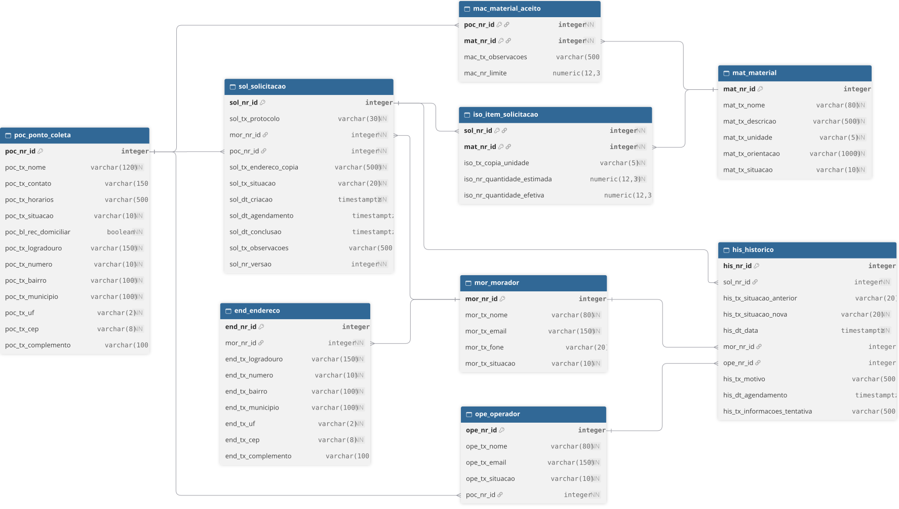

# Sistema de Coleta Seletiva

API REST para conectar **moradores**, **pontos de coleta** e **operadores** responsáveis pelo recolhimento de materiais recicláveis. O sistema reúne informações sobre locais de descarte e materiais aceitos e permite solicitar, agendar e acompanhar recolhimentos em endereços cadastrados.

> Trabalho da disciplina **Programação Web I** — Curso Superior de Sistemas de Informação, Instituto Federal de Sergipe (IFS).

> 🚧 **Status:** em desenvolvimento. Este README é atualizado conforme cada etapa é concluída.

## Sumário

- [Objetivo](#objetivo)
- [Funcionalidades](#funcionalidades)
- [Atores](#atores)
- [Fluxo principal](#fluxo-principal)
- [Situações da solicitação](#situações-da-solicitação)
- [Tecnologias](#tecnologias)
- [Requisitos para executar](#requisitos-para-executar)
- [Como executar](#como-executar)
- [Configuração](#configuração)
- [Documentação da API](#documentação-da-api)
- [Modelo de Banco de Dados](#modelo-de-banco-de-dados)
- [Estrutura do repositório](#estrutura-do-repositório)
- [Roadmap](#roadmap)
- [Contribuindo](#contribuindo)
- [Equipe](#equipe)

## Objetivo

Organizar o cadastro de pontos de coleta, materiais recicláveis e solicitações de recolhimento, garantindo que cada solicitação seja atendida por um ponto **compatível com os materiais informados**.

Objetivos específicos:

- Facilitar a localização de pontos de coleta ativos.
- Informar os materiais aceitos e as orientações de separação.
- Registrar solicitações com vários materiais.
- Controlar agendamentos e situações de atendimento.
- Consultar o histórico dos recolhimentos.

## Funcionalidades

**Cadastros e consultas**

- Moradores e seus endereços.
- Materiais recicláveis (com inativação, sem exclusão física).
- Pontos de coleta e vínculo dos materiais aceitos (com limite opcional por solicitação).
- Operadores vinculados a pontos de coleta.
- Pesquisa de pontos por nome, município, bairro e material aceito, com paginação.

**Recolhimento**

- Criação de solicitação com vários itens e geração de protocolo único.
- Consulta de solicitações com filtros (período, situação e ponto) e paginação.
- Agendamento, recusa e cancelamento, sempre com histórico.
- Início e conclusão do recolhimento, com registro das quantidades efetivas.
- Reagendamento e registro de tentativa sem sucesso.
- Resumo gerencial: solicitações por situação e quantidades recolhidas por material e período.

## Atores

| Ator | Responsabilidades |
|---|---|
| **Morador** | Consultar pontos e materiais, cadastrar seus endereços, solicitar recolhimento, acompanhar e cancelar suas solicitações. |
| **Operador do ponto** | Consultar solicitações do seu ponto, aceitar ou recusar, agendar, iniciar e concluir recolhimentos. |
| **Administrador** | Gerenciar materiais, pontos e responsáveis, vincular materiais aceitos e consultar registros e indicadores. |

## Fluxo principal

1. O administrador cadastra materiais, pontos de coleta e os materiais aceitos em cada ponto.
2. O morador consulta pontos ativos, verifica as orientações e escolhe um ponto com recolhimento domiciliar.
3. O morador informa endereço, materiais, quantidades estimadas e observações. O sistema gera um protocolo e registra a situação `SOLICITADA`.
4. O operador verifica a solicitação, agenda o atendimento ou recusa com justificativa.
5. Na data marcada, o operador inicia o recolhimento, registra as quantidades efetivamente recolhidas e conclui o atendimento.
6. O morador acompanha as alterações e consulta o histórico.

## Situações da solicitação

| Situação atual | Próximas situações permitidas |
|---|---|
| `SOLICITADA` | `AGENDADA`, `RECUSADA` ou `CANCELADA` |
| `AGENDADA` | `EM_RECOLHIMENTO` ou `CANCELADA` (o reagendamento mantém `AGENDADA`) |
| `EM_RECOLHIMENTO` | `CONCLUIDA` ou `AGENDADA` (após tentativa sem sucesso) |
| `CONCLUIDA`, `RECUSADA`, `CANCELADA` | Situações finais, sem novas transições |

## Tecnologias

| Tecnologia | Uso |
|---|---|
| Java 21 | Linguagem |
| Spring Boot 4.1.1 | Framework da aplicação |
| Spring Web | API REST |
| Spring Data JPA | Persistência |
| Bean Validation | Validação de entrada |
| springdoc-openapi | Interface Swagger gerada a partir dos controllers |
| PostgreSQL | Banco de dados relacional |
| Flyway | Migrações do esquema do banco |
| Spring Boot Actuator | Monitoramento (endpoint de saúde) |
| Testcontainers | Testes de integração com PostgreSQL real |
| Docker | Execução dos containers: testes de integração (necessário) e banco de desenvolvimento (opcional, alternativa ao PostgreSQL local) |
| Spring Boot DevTools | Reinício automático durante o desenvolvimento |
| Lombok | Redução de código repetitivo (getters, construtores etc.) |
| Maven (wrapper) | Build e gerenciamento de dependências |

## Requisitos para executar

Para **executar a API**:

- **JDK 21** (variável `JAVA_HOME` apontando para ele).
- **Git**.
- **Um servidor PostgreSQL** acessível, de uma destas formas (você escolhe uma no [passo 3](#3-preparar-o-postgresql)):
  - **PostgreSQL instalado no computador, sem Docker** (opção 1), ou
  - **PostgreSQL em container, com Docker** (opção 2), com o Docker em execução.

Para **executar os testes automatizados** (`mvnw clean verify`), o **Docker em execução é necessário nas duas opções**, porque os testes de integração sobem o próprio PostgreSQL com Testcontainers (veja o [passo 6](#6-executar-os-testes-automatizados)).

O projeto é desenvolvido e testado com o **PostgreSQL 17**, a mesma versão usada pelo `compose.yaml` e pelos testes; prefira essa versão. Não é necessário instalar o Maven: o projeto inclui o *wrapper* (`mvnw` / `mvnw.cmd`).

Para conferir o ambiente:

```bash
java -version
git --version
psql --version     # só se for usar o PostgreSQL instalado no computador
docker version     # só se for usar o Docker (opção 2) ou rodar os testes
```

## Como executar

### 1. Clonar o repositório

```bash
git clone https://github.com/wilgnergomes/sistema-coleta-seletiva.git
cd sistema-coleta-seletiva
```

### 2. Criar o arquivo `.env`

Crie o arquivo `.env` a partir do modelo. Ele guarda a conexão com o banco e **não é versionado** (veja [Configuração](#configuração)):

```bash
# Windows (PowerShell/CMD)
copy .env.example .env

# Linux / macOS / Git Bash
cp .env.example .env
```

Abra o `.env` e **troque a senha**. O restante do arquivo depende da opção escolhida no próximo passo: o modelo vem com `DB_PORT=5433`, pensado para o Docker. Se você usar o PostgreSQL instalado no computador, ajuste a porta conforme a opção 1.

### 3. Preparar o PostgreSQL

Escolha **uma** das opções. A API só precisa de um servidor PostgreSQL acessível e configurado; ela não exige Docker.

#### Opção 1 — PostgreSQL instalado no computador (sem Docker)

Nesta opção o **Docker não é necessário para executar a API**: o PostgreSQL já roda diretamente no seu computador. (O Docker só será preciso para os testes automatizados, no [passo 6](#6-executar-os-testes-automatizados).)

**1.1 Instalar o PostgreSQL.** Baixe o instalador para o seu sistema na [página oficial de downloads](https://www.postgresql.org/download/) (documentação: [PostgreSQL 17](https://www.postgresql.org/docs/17/index.html)). Durante a instalação no Windows, o instalador pede a senha do superusuário `postgres` (guarde-a) e a porta (o padrão é `5432`). Em Linux e macOS também é possível instalar pelo gerenciador de pacotes, por exemplo:

```bash
# Debian / Ubuntu
sudo apt install postgresql

# macOS (Homebrew)
brew install postgresql@17
```

O [pgAdmin](https://www.pgadmin.org/download/), interface gráfica opcional, costuma vir junto no instalador do Windows.

**1.2 Iniciar o serviço.** Confira se o PostgreSQL está rodando e, se não estiver, inicie-o:

```bash
# Windows (PowerShell como administrador; o nome do serviço depende da versão instalada)
Get-Service postgresql*
Start-Service postgresql-x64-17

# Linux (systemd)
sudo systemctl start postgresql

# macOS (Homebrew)
brew services start postgresql@17
```

No Windows também é possível iniciar pelo aplicativo **Serviços** (`services.msc`). Para confirmar que o servidor aceita conexões:

```bash
pg_isready -h localhost -p 5432
```

A resposta esperada é `localhost:5432 - accepting connections`.

**1.3 Acessar o PostgreSQL.** Para criar o usuário e o banco, entre como superusuário (`postgres`):

- **Pelo `psql`:** use a senha do `postgres` definida na instalação.

  ```bash
  psql -U postgres -h localhost -p 5432

  # Linux, se a senha do postgres não foi definida
  sudo -u postgres psql
  ```

  No Windows, se o comando `psql` não for reconhecido, abra o **SQL Shell (psql)** pelo menu Iniciar ou adicione a pasta `bin` da instalação (por exemplo, `C:\Program Files\PostgreSQL\17\bin`) ao `PATH`.
- **Pelo pgAdmin:** conecte ao servidor, clique com o botão direito no banco `postgres` e abra **Query Tool** para executar os comandos SQL abaixo.

**1.4 Criar o usuário e o banco.** Os nomes abaixo são os do `.env.example` (`DB_USER=coleta` e `DB_NAME=coleta_seletiva`). Troque `<SENHA_DO_USUARIO_COLETA>` por uma senha de sua escolha, **sem usar espaços, aspas, `#`, `\` ou `$`** (esses caracteres atrapalham a leitura do `.env`):

```sql
CREATE USER coleta WITH PASSWORD '<SENHA_DO_USUARIO_COLETA>';
CREATE DATABASE coleta_seletiva OWNER coleta;
```

Esses dois comandos já concedem as permissões necessárias. Ao ser o **dono do banco**, o usuário `coleta` pode criar o schema `coleta`, as tabelas e o histórico do Flyway, que são as operações que a aplicação faz ao iniciar. **Você não precisa criar o schema `coleta` nem as tabelas à mão:** o Flyway cuida disso (`spring.flyway.schemas=coleta`). Também não use o superusuário `postgres` na aplicação.

Se o banco **já existia** com outro dono, conceda as permissões ao usuário em vez de criá-lo de novo:

```sql
GRANT ALL PRIVILEGES ON DATABASE coleta_seletiva TO coleta;
```

Saia do `psql` com `\q` e confirme que o novo usuário consegue entrar (ele pede a senha):

```bash
psql -U coleta -h localhost -p 5432 -d coleta_seletiva -c "\conninfo"
```

**1.5 Ajustar o `.env`.** Use o nome, o usuário e a senha criados acima e a **porta do seu servidor**:

```properties
DB_NAME=coleta_seletiva
DB_USER=coleta
DB_PASSWORD=<a mesma senha usada no CREATE USER>
DB_PORT=5432
```

**Atenção à porta.** O `.env.example` traz `DB_PORT=5433` porque está preparado para o Docker, onde a porta `5433` do computador é ligada à `5432` do container (assim ele não colide com um PostgreSQL já instalado). Em uma instalação local não existe esse mapeamento: a porta é a em que o próprio servidor escuta, normalmente a padrão **`5432`**. Por isso, **altere `DB_PORT` para `5432` no seu `.env`**. Se você escolheu outra porta na instalação, use essa. Para descobrir a porta, execute `SHOW port;` no `psql`. O arquivo `.env.example` não deve ser alterado.

Pronto: siga para o [passo 4](#4-iniciar-a-api).

#### Opção 2 — PostgreSQL com Docker

Requer o **Docker** em execução. O container cria o banco e o usuário sozinho, a partir do `.env`: não é preciso instalar o PostgreSQL nem executar comandos SQL. O `.env` pode ficar com o `DB_PORT=5433` do modelo (a porta do seu computador que é ligada à `5432` do container). Se a `5433` já estiver ocupada, escolha outra porta livre.

Suba o banco e confirme que o serviço `db` está `healthy`:

```bash
docker compose up -d
docker compose ps
```

Os dados ficam em um volume do Docker (`coleta_pgdata`), então são mantidos ao parar ou remover o container.

Comandos úteis:

```bash
docker compose logs -f db      # acompanhar os logs
docker compose stop            # parar o banco (os dados são mantidos)
docker compose down            # remove o container e mantém os dados
```

Para apagar o banco e recomeçar do zero (**destrói todos os dados**), confira o volume antes e depois:

```bash
docker volume ls --filter name=coleta
docker compose down -v
docker volume ls --filter name=coleta
```

### 4. Iniciar a API

Com o banco pronto e o `.env` preenchido, inicie a aplicação:

```bash
# Windows (PowerShell/CMD)
.\mvnw.cmd spring-boot:run

# Linux / macOS / Git Bash
./mvnw spring-boot:run
```

> Execute sempre a partir da raiz do projeto, para que o arquivo `.env` seja encontrado. Ao iniciar, a aplicação conecta ao banco e o Flyway aplica as migrações de `src/main/resources/db/migration`, criando o schema `coleta` e as tabelas na primeira execução. Se a porta `8080` estiver ocupada, acrescente `-Dspring-boot.run.arguments=--server.port=8081` ao comando.

### 5. Verificar o funcionamento

Verifique se a aplicação está no ar pelo Actuator:

```bash
# Windows (PowerShell)
curl.exe http://localhost:8080/actuator/health

# Demais terminais
curl http://localhost:8080/actuator/health
```

A resposta esperada contém `"status":"UP"`, o que indica que a aplicação iniciou **e** consegue usar o banco. A interface Swagger fica em <http://localhost:8080/swagger-ui/index.html>.

Para conferir que o Flyway criou o schema `coleta` e as tabelas, liste as tabelas e as migrações aplicadas:

```bash
# PostgreSQL instalado no computador (ajuste a porta se necessário)
psql -U coleta -h localhost -p 5432 -d coleta_seletiva -c "\dt coleta.*" -c "SELECT version, description, success FROM coleta.flyway_schema_history;"

# PostgreSQL com Docker (use o usuário e o banco do seu .env)
docker compose exec db psql -U coleta -d coleta_seletiva -c "\dt coleta.*" -c "SELECT version, description, success FROM coleta.flyway_schema_history;"
```

O esperado são **10 tabelas** no schema `coleta` (as 9 do sistema mais `flyway_schema_history`) e as migrações 1, 2 e 3 com `success = t`. No pgAdmin, o mesmo aparece em *Schemas > coleta > Tables*.

### 6. Executar os testes automatizados

```bash
# Windows (PowerShell/CMD)
.\mvnw.cmd clean verify

# Linux / macOS / Git Bash
./mvnw clean verify
```

Os testes são independentes da forma como você executa o banco de desenvolvimento:

- Os **testes de integração usam Testcontainers**, que sobe um PostgreSQL descartável em um container. Por isso exigem um **ambiente de containers compatível, normalmente o Docker em execução**, mesmo que você use o PostgreSQL instalado no computador para rodar a API.
- Esse banco é **separado do banco de desenvolvimento**: os testes não leem nem alteram os dados do banco configurado no `.env`.
- **Não é preciso deixar a API iniciada** para executar os testes.

### 7. Executar com dados de demonstração (perfil `demo`)

Para carregar os dados fictícios de demonstração (hoje, 5 moradores do RF01, 7 endereços do RF02, 7 materiais do RF03, 5 pontos de coleta do RF04, 14 vínculos de materiais do RF05, 3 operadores do RF07 e 11 solicitações dos RF09 e RF15, uma em cada situação e quatro concluídas), ative o perfil `demo` ao iniciar a API:

```bash
# Windows (PowerShell/CMD)
.\mvnw.cmd spring-boot:run "-Dspring-boot.run.profiles=demo"

# Linux / macOS / Git Bash
./mvnw spring-boot:run -Dspring-boot.run.profiles=demo
```

Os scripts ficam em `src/main/resources/db/seed` e rodam a cada início do perfil, sem duplicar dados (ADR 0022). Sem o perfil, nenhum dado de demonstração é carregado. Para usar um morador como ator, consulte os ids em `GET /moradores` (cabeçalho `X-Perfil: ADMINISTRADOR`) e envie `X-Perfil: MORADOR` com `X-Usuario-Id` igual ao id.

### 8. Encerrar os serviços

- **API:** pressione `Ctrl+C` no terminal em que ela está rodando.
- **PostgreSQL instalado no computador:** não precisa ser parado; se quiser, pare o serviço (`Stop-Service postgresql-x64-17` no Windows, `sudo systemctl stop postgresql` no Linux ou `brew services stop postgresql@17` no macOS). Os dados são mantidos.
- **PostgreSQL com Docker:** `docker compose stop` (os dados são mantidos).

## Configuração

A conexão com o banco é configurada por **variáveis de ambiente**. Nenhuma senha, token ou credencial é versionado no repositório.

Os valores ficam no arquivo `.env`, na raiz do projeto, que **não é versionado** (está no `.gitignore`). O arquivo `.env.example` é o modelo, com valores fictícios e a porta preparada para o Docker (`DB_PORT=5433`). A aplicação lê o `.env`; na opção 2, o Docker Compose lê o mesmo arquivo. Variáveis de ambiente definidas no sistema ou no CI também funcionam e prevalecem sobre o arquivo.

| Variável | Descrição | Exemplo |
|----------|-----------|---------|
| `DB_NAME` | Nome do banco. **PostgreSQL local:** o banco que você criou com `CREATE DATABASE`. **Docker:** criado automaticamente na primeira subida do container | `coleta_seletiva` |
| `DB_USER` | Usuário do banco. **Local:** o que você criou com `CREATE USER`, dono do banco. **Docker:** criado automaticamente | `coleta` |
| `DB_PASSWORD` | Senha do usuário (obrigatória, sem valor padrão). **Local:** a do `CREATE USER`. **Docker:** definida na primeira criação do volume | `defina-uma-senha-aqui` |
| `DB_PORT` | Porta em que a API procura o PostgreSQL, sempre em `localhost`. **PostgreSQL local:** a porta do próprio servidor, normalmente `5432`. **Docker:** a porta do seu computador ligada à `5432` do container, `5433` no modelo para não colidir com um PostgreSQL local | `5432` (local) ou `5433` (Docker) |

Na aplicação, o `application.properties` monta a conexão `jdbc:postgresql://localhost:${DB_PORT}/${DB_NAME}?currentSchema=coleta` a partir dessas variáveis. O schema `coleta` pertence às migrações do Flyway (`spring.flyway.schemas=coleta`) e o Hibernate apenas valida o mapeamento. Os dois modos de execução usam essa mesma configuração, sem nenhum arquivo adicional: o que muda é só o valor de `DB_PORT`.

### Problemas comuns

- **`Connection to localhost:XXXX refused`:** não há servidor escutando nessa porta. Inicie o PostgreSQL (serviço local ou `docker compose up -d`) e confira o `DB_PORT` no `.env`. No PostgreSQL local, `pg_isready -h localhost -p 5432` ajuda a confirmar.
- **`password authentication failed for user "coleta"`:** a senha do `.env` não é a do usuário, ou o usuário não existe, ou **outro PostgreSQL responde na porta configurada** (por exemplo, `DB_PORT=5432` apontando para a instalação local quando você queria o Docker, ou o contrário). No PostgreSQL local, redefina a senha com `ALTER USER coleta WITH PASSWORD '<NOVA_SENHA>';` e atualize o `.env`.
- **`database "..." does not exist`:** crie o banco (`CREATE DATABASE`, passo 1.4) ou corrija `DB_NAME` no `.env`.
- **`permission denied for database ...`:** o usuário não pode criar o schema `coleta`. Torne-o dono do banco (`ALTER DATABASE coleta_seletiva OWNER TO coleta;`) ou conceda `GRANT ALL PRIVILEGES ON DATABASE coleta_seletiva TO coleta;`.
- **`Could not resolve placeholder 'DB_PASSWORD'`:** o `.env` não existe ou a aplicação foi executada fora da raiz do projeto.
- **Porta `8080` em uso ao iniciar a API:** feche o programa que a usa ou inicie a API em outra porta (veja o passo 4).
- **Docker, porta já em uso ao subir o banco:** troque `DB_PORT` no `.env` e rode `docker compose up -d` de novo.
- **Docker, o compose pede para definir `DB_PASSWORD`:** o `.env` não foi criado (passo 2).
- **Docker, troquei a senha no `.env` e a conexão falha:** usuário e senha só valem na primeira criação do banco. Apague o volume (comando do passo 3, opção 2) e suba de novo.
- **Os testes falham dizendo que não encontram um ambiente Docker:** inicie o Docker; os testes de integração precisam dele mesmo com o PostgreSQL local.

## Documentação da API

O contrato da API está em [`docs/api/openapi.yaml`](docs/api/openapi.yaml), no formato OpenAPI 3.0. Ele é a fonte da verdade dos endpoints, dos formatos de entrada e saída e das respostas de erro (ADR 0017). Para ler, abra o arquivo em um editor com pré-visualização de OpenAPI ou cole o conteúdo em [editor.swagger.io](https://editor.swagger.io).

Com a aplicação em execução, a interface Swagger gerada pelo springdoc fica em <http://localhost:8080/swagger-ui/index.html> e o JSON em <http://localhost:8080/v3/api-docs>. Ela funciona como manual interativo: cada operação traz resumo, descrição, quem pode executá-la, parâmetros, exemplos de corpo JSON e as respostas de sucesso e de erro. Para executar as operações que exigem ator, clique em **Authorize** e informe `X-Perfil` (`ADMINISTRADOR`, `MORADOR` ou `OPERADOR`) e, para morador e operador, `X-Usuario-Id`; as consultas públicas e o `POST /moradores` funcionam sem isso. A identificação por cabeçalhos é uma simplificação para demonstração, não autenticação (ADR 0019). Cada endpoint e seu estado de implementação são acompanhados na [matriz de rastreabilidade](docs/requirements/matriz-rastreabilidade.md).

Convenções da API (ADR 0018):

- JSON como formato de troca.
- Códigos HTTP: `201` para criação, `400` para entrada inválida, `403` para operação não permitida ao ator, `404` para registro ausente e `409` para conflitos de regra ou de versão.
- Erros no formato `{ codigo, mensagem, erros }`, sem stack trace.
- Listagens paginadas, com limite máximo de 100 registros por página.
- Ator identificado pelos cabeçalhos `X-Perfil` e `X-Usuario-Id`, apenas para demonstração, sem autenticação (ADR 0019).
- Idioma das mensagens de erro e de validação pelo cabeçalho `Accept-Language`: português do Brasil (padrão) ou inglês (`en`). Só o texto de `mensagem` muda; `codigo`, status e estrutura do erro permanecem (ADR 0023). Exemplo: `curl -H "Accept-Language: en" ...`. As mensagens ficam em `src/main/resources/messages.properties` e `messages_en.properties`.

## Modelo de Banco de Dados

O modelo físico do banco está documentado em **um único DER**, com as 9 tabelas, seus campos, tipos, chaves e as 11 chaves estrangeiras (ADR 0025). A fonte da verdade do banco são as migrações Flyway; o diagrama é mantido em sincronia com elas.



> 📝 [Ver código fonte do diagrama (DBML)](docs/diagramas/entidade-relacionamento-fisico/der-unificado.dbml)

## Estrutura do repositório

```text
.
├── docs/            # Documentação do projeto
│   ├── adr/         # Registros de Decisão de Arquitetura (ADRs)
│   ├── api/         # Contrato da API (OpenAPI)
│   ├── diagramas/   # Modelos Entidade-Relacionamento e diagramas visuais
│   ├── referencias/ # Enunciado original da atividade
│   ├── requirements/# Matriz de rastreabilidade
│   └── melhorias-pendentes.md  # Melhorias não críticas, para depois
├── src/
│   ├── main/        # Código-fonte (Java/Spring) e migrações do banco (Flyway)
│   └── test/        # Testes automatizados
├── mvnw / mvnw.cmd  # Maven Wrapper
├── pom.xml          # Dependências e configuração do build
└── README.md
```

> A pasta `docs/` reúne os ADRs, o contrato OpenAPI, os diagramas, a matriz de rastreabilidade, as referências e os relatórios de auditoria.

## Roadmap

- [x] Levantamento de requisitos
- [x] Criação do repositório e do projeto Spring Boot
- [x] Modelagem do banco de dados (diagrama ER e migrações)
- [x] Criação da [Matriz de Rastreabilidade](docs/requirements/matriz-rastreabilidade.md)
- [x] Configuração do banco com Docker Compose
- [x] Contrato da API (OpenAPI)
- [x] Fundação da API (springdoc, tratamento de erros, paginação, identificação do ator)
- [x] Cadastro de moradores (RF01)
- [x] Cadastro de endereços dos moradores (RF02)
- [x] Cadastro de materiais recicláveis (RF03)
- [x] Cadastro de pontos de coleta (RF04)
- [x] Vínculo de materiais aos pontos de coleta (RF05)
- [x] Cadastro de operadores e vínculo com os pontos (RF07)
- [x] Pesquisa de pontos e materiais com filtros e paginação (RF06)
- [x] Consultas de solicitações com filtros e paginação (RF09)
- [x] Solicitação de recolhimento (compatibilidade, itens e protocolo) (RF08)
- [x] Transições de situação e histórico (RF10 a RF14)
- [x] Resumo gerencial (RF15)
- [x] Bloqueio da inativação de ponto e da remoção de vínculo com solicitações abertas (RN05)
- [x] Dataset de desempenho e medição inicial do RNF04 (Issue #58, etapa 1; veja [docs/desempenho](docs/desempenho/README.md))
- [ ] Testes de integração e de concorrência
- [ ] Interface web responsiva (segunda unidade)

## Contribuindo

Fluxo de trabalho da equipe (branches, commits e Pull Requests): veja o [CONTRIBUTING.md](CONTRIBUTING.md).

## Equipe

| Nome | GitHub |
|---|---|
| _Wilgner_ | [@wilgnergomes](https://github.com/wilgnergomes) |
| _Nome do integrante_ | [@usuario](https://github.com/usuario) |
| _Nome do integrante_ | [@usuario](https://github.com/usuario) |

---

Projeto acadêmico. Todos os dados utilizados na demonstração são fictícios.