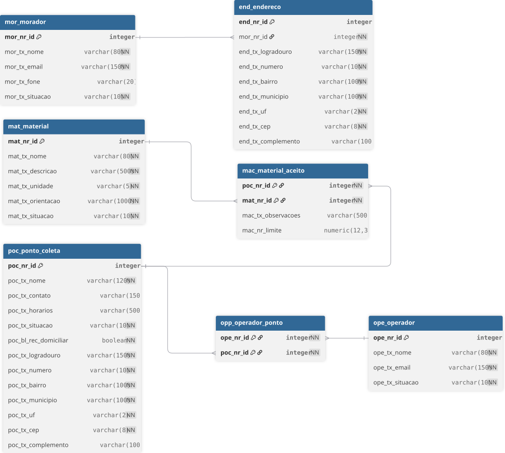
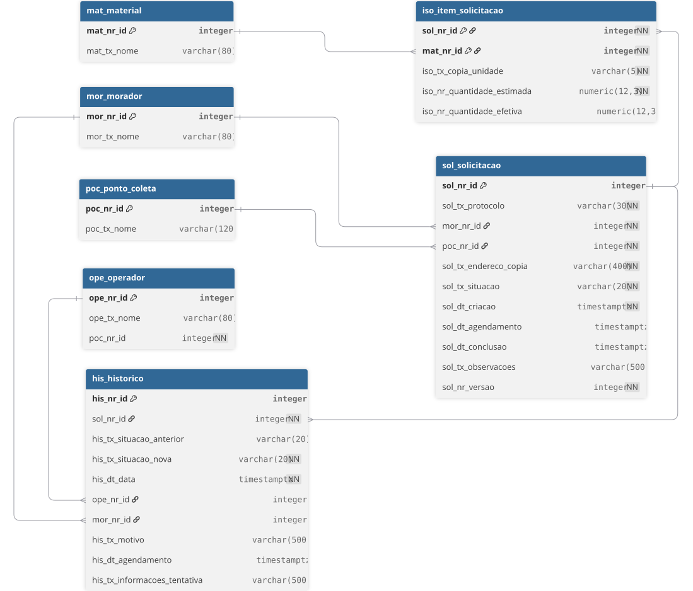

# Sistema de Coleta Seletiva

API REST para conectar **moradores**, **pontos de coleta** e **operadores** responsáveis pelo recolhimento de materiais recicláveis. O sistema reúne informações sobre locais de descarte e materiais aceitos e permite solicitar, agendar e acompanhar recolhimentos em endereços cadastrados.

> Trabalho da disciplina **Programação Web I** — Curso Superior de Sistemas de Informação, Instituto Federal de Sergipe (IFS).

> 🚧 **Status:** em desenvolvimento. Este README é atualizado conforme cada etapa é concluída.

## Sumário

- [Objetivo](#objetivo)
- [Funcionalidades](#funcionalidades)
- [Atores](#atores)
- [Fluxo principal](#fluxo-principal)
- [Situações da solicitação](#situações-da-solicitação)
- [Tecnologias](#tecnologias)
- [Requisitos para executar](#requisitos-para-executar)
- [Como executar](#como-executar)
- [Configuração](#configuração)
- [Documentação da API](#documentação-da-api)
- [Modelo de Banco de Dados](#modelo-de-banco-de-dados)
- [Estrutura do repositório](#estrutura-do-repositório)
- [Roadmap](#roadmap)
- [Contribuindo](#contribuindo)
- [Equipe](#equipe)

## Objetivo

Organizar o cadastro de pontos de coleta, materiais recicláveis e solicitações de recolhimento, garantindo que cada solicitação seja atendida por um ponto **compatível com os materiais informados**.

Objetivos específicos:

- Facilitar a localização de pontos de coleta ativos.
- Informar os materiais aceitos e as orientações de separação.
- Registrar solicitações com vários materiais.
- Controlar agendamentos e situações de atendimento.
- Consultar o histórico dos recolhimentos.

## Funcionalidades

**Cadastros e consultas**

- Moradores e seus endereços.
- Materiais recicláveis (com inativação, sem exclusão física).
- Pontos de coleta e vínculo dos materiais aceitos (com limite opcional por solicitação).
- Operadores vinculados a pontos de coleta.
- Pesquisa de pontos por nome, município, bairro e material aceito, com paginação.

**Recolhimento**

- Criação de solicitação com vários itens e geração de protocolo único.
- Consulta de solicitações com filtros (período, situação e ponto) e paginação.
- Agendamento, recusa e cancelamento, sempre com histórico.
- Início e conclusão do recolhimento, com registro das quantidades efetivas.
- Reagendamento e registro de tentativa sem sucesso.
- Resumo gerencial: solicitações por situação e quantidades recolhidas por material e período.

## Atores

| Ator | Responsabilidades |
|---|---|
| **Morador** | Consultar pontos e materiais, cadastrar seus endereços, solicitar recolhimento, acompanhar e cancelar suas solicitações. |
| **Operador do ponto** | Consultar solicitações do seu ponto, aceitar ou recusar, agendar, iniciar e concluir recolhimentos. |
| **Administrador** | Gerenciar materiais, pontos e responsáveis, vincular materiais aceitos e consultar registros e indicadores. |

## Fluxo principal

1. O administrador cadastra materiais, pontos de coleta e os materiais aceitos em cada ponto.
2. O morador consulta pontos ativos, verifica as orientações e escolhe um ponto com recolhimento domiciliar.
3. O morador informa endereço, materiais, quantidades estimadas e observações. O sistema gera um protocolo e registra a situação `SOLICITADA`.
4. O operador verifica a solicitação, agenda o atendimento ou recusa com justificativa.
5. Na data marcada, o operador inicia o recolhimento, registra as quantidades efetivamente recolhidas e conclui o atendimento.
6. O morador acompanha as alterações e consulta o histórico.

## Situações da solicitação

| Situação atual | Próximas situações permitidas |
|---|---|
| `SOLICITADA` | `AGENDADA`, `RECUSADA` ou `CANCELADA` |
| `AGENDADA` | `EM_RECOLHIMENTO` ou `CANCELADA` (o reagendamento mantém `AGENDADA`) |
| `EM_RECOLHIMENTO` | `CONCLUIDA` ou `AGENDADA` (após tentativa sem sucesso) |
| `CONCLUIDA`, `RECUSADA`, `CANCELADA` | Situações finais, sem novas transições |

## Tecnologias

| Tecnologia | Uso |
|---|---|
| Java 21 | Linguagem |
| Spring Boot 4.1.1 | Framework da aplicação |
| Spring Web | API REST |
| Spring Data JPA | Persistência |
| Bean Validation | Validação de entrada |
| PostgreSQL | Banco de dados relacional |
| Flyway | Migrações do esquema do banco |
| Spring Boot Actuator | Monitoramento (endpoint de saúde) |
| Testcontainers | Testes de integração com PostgreSQL real |
| Docker | Execução dos containers (testes de integração e, futuramente, banco de desenvolvimento) |
| Spring Boot DevTools | Reinício automático durante o desenvolvimento |
| Lombok | Redução de código repetitivo (getters, construtores etc.) |
| Maven (wrapper) | Build e gerenciamento de dependências |

## Requisitos para executar

- **JDK 21** (variável `JAVA_HOME` apontando para ele).
- **Docker** em execução (necessário para os testes de integração com Testcontainers).
- **Git**.

Não é necessário instalar o Maven: o projeto inclui o *wrapper* (`mvnw` / `mvnw.cmd`).

Para conferir o ambiente:

```bash
java -version
docker version
```

## Como executar

Clone o repositório:

```bash
git clone https://github.com/<usuario>/sistema-coleta-seletiva.git
cd sistema-coleta-seletiva
```

Crie o arquivo `.env` a partir do modelo e **troque a senha** (veja [Configuração](#configuração)):

```bash
# Windows (PowerShell/CMD)
copy .env.example .env

# Linux / macOS / Git Bash
cp .env.example .env
```

Suba o banco de dados (PostgreSQL em container) e confirme que o serviço `db` está `healthy`:

```bash
docker compose up -d
docker compose ps
```

Compilar e executar os testes:

```bash
# Windows (PowerShell/CMD)
.\mvnw.cmd clean verify

# Linux / macOS / Git Bash
./mvnw clean verify
```

> Os testes que carregam o contexto da aplicação precisam do banco no ar e do `.env` criado.

Executar a aplicação:

```bash
# Windows (PowerShell/CMD)
.\mvnw.cmd spring-boot:run

# Linux / macOS / Git Bash
./mvnw spring-boot:run
```

> Execute sempre a partir da raiz do projeto, para que o arquivo `.env` seja encontrado. Ao iniciar, a aplicação aplica as migrações de `src/main/resources/db/migration`.

Verificar se a aplicação está no ar:

```bash
# Windows (PowerShell)
curl.exe http://localhost:8080/actuator/health

# Demais terminais
curl http://localhost:8080/actuator/health
```

Parar o banco quando terminar (os dados são mantidos):

```bash
docker compose stop
```

## Configuração

As credenciais e parâmetros de conexão com o banco são configurados por **variáveis de ambiente**. Nenhuma senha, token ou credencial é versionado no repositório.

Os valores ficam no arquivo `.env`, na raiz do projeto, que **não é versionado** (está no `.gitignore`). O arquivo `.env.example` é o modelo, com valores fictícios. O Docker Compose e a aplicação leem o mesmo `.env`. Variáveis de ambiente definidas no sistema ou no CI também funcionam e prevalecem sobre o arquivo.

| Variável | Descrição | Exemplo |
|----------|-----------|---------|
| `DB_NAME` | Nome do banco | `coleta_seletiva` |
| `DB_USER` | Usuário do banco | `coleta` |
| `DB_PASSWORD` | Senha do banco (obrigatória, sem valor padrão) | `defina-uma-senha-aqui` |
| `DB_PORT` | Porta do seu computador mapeada para a 5432 do container. Use 5433 para não colidir com um PostgreSQL local | `5433` |

### Comandos úteis do banco

```bash
docker compose logs -f db      # acompanhar os logs
docker compose down            # remove o container e mantém os dados
```

Para apagar o banco e recomeçar do zero (**destrói todos os dados**), confira o volume antes e depois:

```bash
docker volume ls --filter name=coleta
docker compose down -v
docker volume ls --filter name=coleta
```

### Problemas comuns

- **Porta já em uso ao subir o banco:** troque `DB_PORT` no `.env` e rode `docker compose up -d` de novo.
- **`Could not resolve placeholder 'DB_PASSWORD'`:** o `.env` não existe ou a aplicação foi executada fora da raiz do projeto.
- **O compose pede para definir `DB_PASSWORD`:** o `.env` não foi criado (veja "Como executar").
- **Troquei a senha no `.env` e a conexão falha:** usuário e senha só valem na primeira criação do banco. Apague o volume (comando acima) e suba de novo.

## Documentação da API

O contrato da API está em [`docs/api/openapi.yaml`](docs/api/openapi.yaml), no formato OpenAPI 3.0. Ele é a fonte da verdade dos endpoints, dos formatos de entrada e saída e das respostas de erro (ADR 0017). Para ler, abra o arquivo em um editor com pré-visualização de OpenAPI ou cole o conteúdo em [editor.swagger.io](https://editor.swagger.io).

A interface Swagger gerada pela aplicação será disponibilizada quando os primeiros endpoints forem implementados (Ciclo 1). Cada endpoint e seu estado de implementação são acompanhados na [matriz de rastreabilidade](docs/matriz-rastreabilidade.md).

Convenções da API (ADR 0018):

- JSON como formato de troca.
- Códigos HTTP: `201` para criação, `400` para entrada inválida, `403` para operação não permitida ao ator, `404` para registro ausente e `409` para conflitos de regra ou de versão.
- Erros no formato `{ codigo, mensagem, erros }`, sem stack trace.
- Listagens paginadas, com limite máximo de 100 registros por página.
- Ator identificado pelos cabeçalhos `X-Perfil` e `X-Usuario-Id`, apenas para demonstração, sem autenticação (ADR 0019).

## Modelo de Banco de Dados

O banco de dados foi modelado em múltiplas visões para facilitar o entendimento dos domínios.

### 1. Visão Estrutural (Cadastros)
Esta visão apresenta as entidades base do sistema.



> 📝 [Ver código fonte do diagrama (DBML)](docs/diagramas/entidade-relacionamento-fisico/der-estrutural.dbml)

### 2. Visão Transacional (Fluxo de Recolhimento)
Esta visão detalha o fluxo principal e o histórico de ações.



> 📝 [Ver código fonte do diagrama (DBML)](docs/diagramas/entidade-relacionamento-fisico/der-transacional.dbml)

## Estrutura do repositório

```text
.
├── docs/            # Documentação do projeto
│   ├── adr/         # Registros de Decisão de Arquitetura (ADRs)
│   ├── api/         # Contrato da API (OpenAPI)
│   └── diagramas/   # Modelos Entidade-Relacionamento e diagramas visuais
├── src/
│   ├── main/        # Código-fonte (Java/Spring) e migrações do banco (Flyway)
│   └── test/        # Testes automatizados
├── mvnw / mvnw.cmd  # Maven Wrapper
├── pom.xml          # Dependências e configuração do build
└── README.md
```

> A pasta `docs/` será criada conforme os documentos forem produzidos.

## Roadmap

- [x] Levantamento de requisitos
- [x] Criação do repositório e do projeto Spring Boot
- [x] Modelagem do banco de dados (diagrama ER e migrações)
- [x] Criação da [Matriz de Rastreabilidade](docs/matriz-rastreabilidade.md)
- [x] Configuração do banco com Docker Compose
- [x] Contrato da API (OpenAPI)
- [ ] Fundação da API (springdoc, tratamento de erros, paginação, identificação do ator)
- [ ] Cadastros: materiais, pontos, vínculos, moradores, endereços e operadores
- [ ] Consultas com filtros e paginação
- [ ] Solicitação de recolhimento (compatibilidade, itens e protocolo)
- [ ] Transições de situação e histórico
- [ ] Resumo gerencial
- [ ] Testes de integração e de concorrência
- [ ] Interface web responsiva (segunda unidade)

## Contribuindo

Fluxo de trabalho da equipe (branches, commits e Pull Requests): veja o [CONTRIBUTING.md](CONTRIBUTING.md).

## Equipe

| Nome | GitHub |
|---|---|
| _Wilgner_ | [@wilgnergomes](https://github.com/wilgnergomes) |
| _Nome do integrante_ | [@usuario](https://github.com/usuario) |
| _Nome do integrante_ | [@usuario](https://github.com/usuario) |

---

Projeto acadêmico. Todos os dados utilizados na demonstração são fictícios.