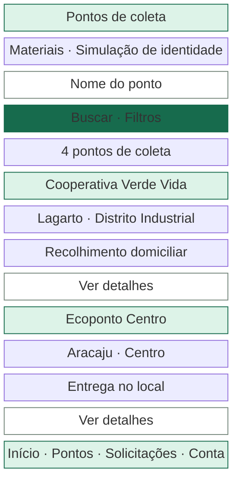
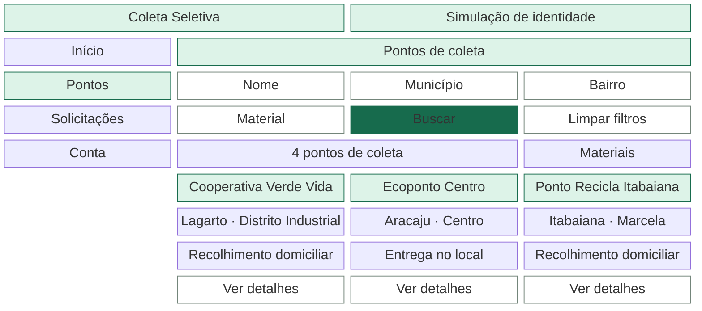
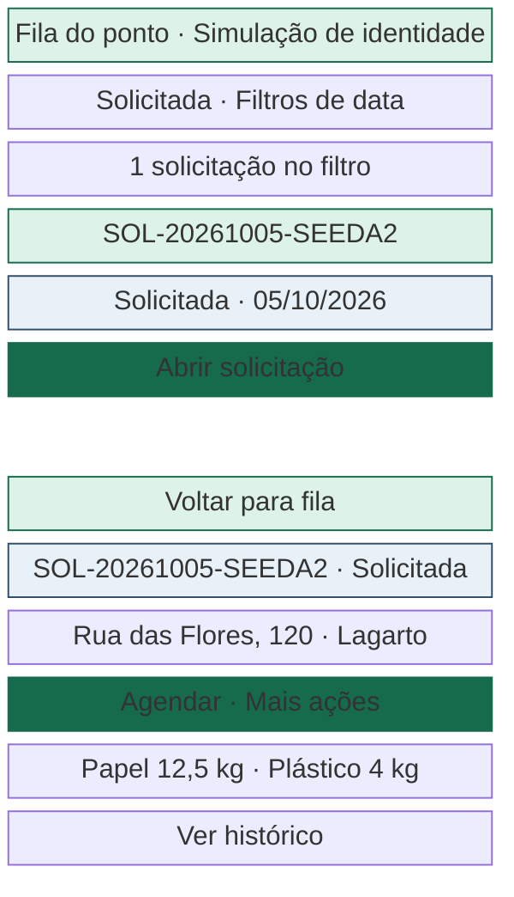
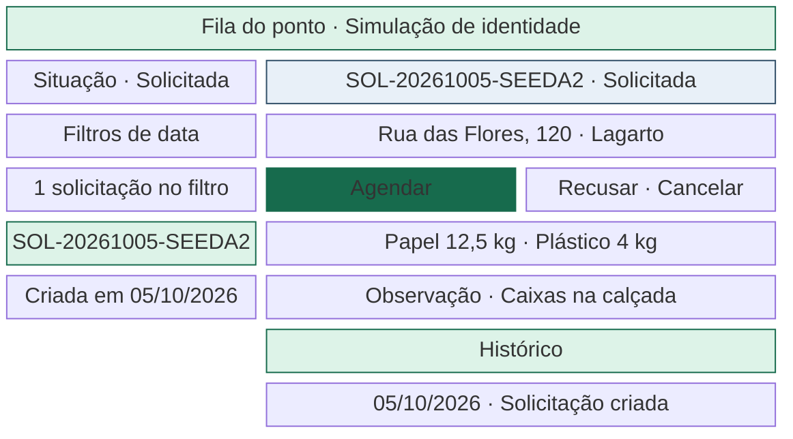
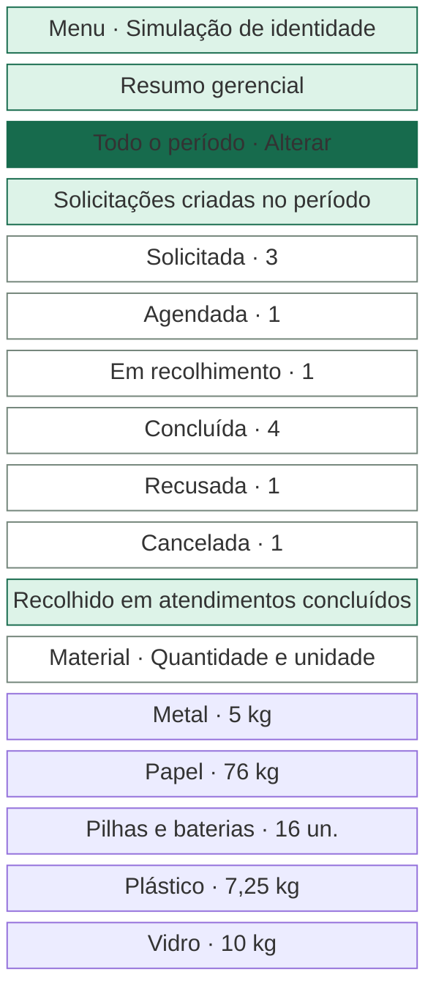
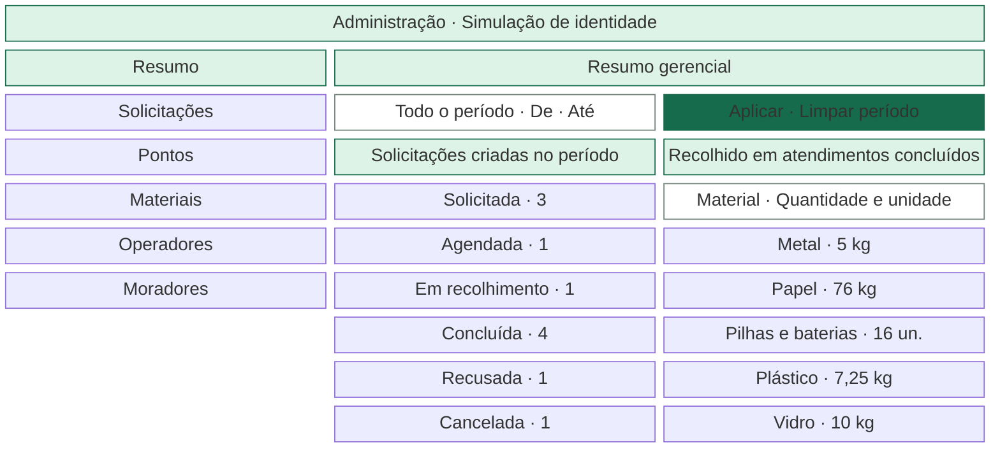

# Design system e responsividade

[Plano mestre](PLANO_MESTRE_FRONTEND.md) · [Telas](TELAS_E_NAVEGACAO.md) · [Aceites de interface](TESTES_E_IMPLEMENTACAO.md)

## Minimalismo Funcional Sustentável

Use Material 3 com superfícies claras, poucos níveis de elevação e verde para a ação principal. Cada tela tem um título e uma ação primária quando houver uma próxima tarefa clara. As descrições entram quando ajudam a tomar uma decisão, como o limite de material ou o impacto de inativar um ponto. Ícones de linha do Material acompanham rótulos nas ações importantes. Ilustrações têm intensidade 1/5. A primeira implementação pode resolver estados vazios e confirmações com um ícone de até 48 dp e texto curto. [Material 3 no Flutter](https://docs.flutter.dev/release/breaking-changes/material-3-default)

### Paleta

| Papel | Valor | Aplicação |
|---|---|---|
| Primário | `#176B4D` | Ação principal, seleção e links identificados visualmente |
| Sobre primário | `#FFFFFF` | Texto e ícone de botão preenchido |
| Secundário suave | `#83B89C` | Fundo de destaque com texto escuro |
| Fundo | `#F7F9F7` | Tela e áreas sem elevação |
| Superfície | `#FFFFFF` | Formulários, cartões, painéis e diálogos |
| Texto principal | `#24352D` | Títulos, corpo e números |
| Texto secundário | `#52665B` | Descrições, ajuda e metadados |
| Contorno interativo | `#73857A` | Campos e controles que precisam de contorno perceptível |
| Divisor | `#DCE4DE` | Separação decorativa de linhas e seções |
| Destaque | `#E9AD55` | Elemento pontual com texto `#24352D` |
| Foco | `#1C5FB8` | Anel de 2 dp com separação de 2 dp. Em superfícies escuras, usar também a borda interna clara. |

Contrastes calculados a partir dos hexadecimais, para cores sólidas. `#24352D` sobre o fundo é **12,24:1**, `#FFFFFF` sobre o primário **6,47:1**, texto sobre secundário suave **5,73:1**, texto sobre destaque **6,52:1**, texto secundário sobre o fundo **5,82:1**, contorno sobre o fundo **3,70:1** e foco sobre o fundo **5,88:1**. O destaque com texto branco teria **1,99:1**, por isso o token de texto escuro é parte do componente. O alvo é 4,5:1 para texto comum e 3:1 para texto grande e partes essenciais de controles. Testar o contraste renderizado, inclusive em estados de interação. [WCAG 2.2 · contraste de texto](https://www.w3.org/WAI/WCAG22/Understanding/contrast-minimum.html) · [WCAG 2.2 · contraste de componentes](https://www.w3.org/WAI/WCAG22/Understanding/non-text-contrast.html)

### Situações e feedback

| Valor da API ou uso | Rótulo | Texto e ícone | Fundo | Ícone sugerido | Contraste |
|---|---|---|---|---|---:|
| `SOLICITADA` | Solicitada | `#304E67` | `#E8F0F8` | `schedule` | 7,57:1 |
| `AGENDADA` | Agendada | `#165670` | `#DDF1F8` | `event` | 6,93:1 |
| `EM_RECOLHIMENTO` | Em recolhimento | `#694400` | `#FFF1D6` | `local_shipping_outlined` | 7,75:1 |
| `CONCLUIDA` | Concluída | `#176044` | `#DDF3E8` | `check_circle_outline` | 6,47:1 |
| `RECUSADA` | Recusada | `#922E2C` | `#FCE8E7` | `block` | 6,73:1 |
| `CANCELADA` | Cancelada | `#4C5850` | `#E9EEEA` | `cancel_outlined` | 6,34:1 |
| `ATIVO` / `INATIVO` | Ativo / Inativo | Verde de sucesso / neutro | `#DDF3E8` / `#E9EEEA` | `check_circle_outline` / `pause_circle_outline` | 6,47 / 6,34:1 |
| Sucesso | Mensagem da ação | `#176044` | `#DDF3E8` | `check_circle_outline` | 6,47:1 |
| Alerta | Aviso e ação sugerida | `#694400` | `#FFF1D6` | `warning_amber_rounded` | 7,75:1 |
| Erro | Problema e orientação | `#922E2C` | `#FCE8E7` | `error_outline` | 6,73:1 |

Implemente os papéis globais em `ColorScheme` e os de situação em uma `ThemeExtension` pequena. Rótulo e ícone seguem juntos em linhas de status e na linha do tempo. `CONCLUIDA` continua sem acento no JSON. Para enum desconhecido recebido, use rótulo neutro de situação indisponível, mantenha a leitura e suspenda ações que dependem dele. O texto de erros de campo usa o papel de erro com fundo da superfície. Ícones ao lado de rótulos acessíveis são decorativos para o leitor de tela.

### Tipografia, espaço e forma

| Elemento | Token inicial em unidades lógicas |
|---|---|
| Família | Inter local, regular 400 e semibold 600, com caracteres do português. Distribuir com a licença. Usar fontes padrão do Flutter no primeiro teste de infraestrutura. |
| Título de página | 28/36 e peso 600. Em área compacta, 24/32. |
| Título de seção / cartão | 20/28 e 16/24, peso 600 |
| Corpo, campos e botões | 16/24 no corpo e campos, 14/20 e peso 600 nos botões |
| Auxiliar e dados densos | 14/20 em texto secundário e linhas. 12/16 só para metadados curtos e chips, com escalonamento preservado. |
| Espaçamento | 4, 8, 12, 16, 24, 32 e 48 dp. Entre campos 16, entre seções 24. |
| Margens laterais | 16 dp no compacto, 24 dp no intermediário e 24–32 dp no amplo, após a navegação |
| Bordas | 1 dp de contorno. Campos e botões 8 dp de raio, cartões 12 dp, diálogos 16 dp. |
| Alvo interativo | 48 × 48 dp para toque e controles de ícone. Pode crescer com fonte e conteúdo. |
| Alturas | Linhas densas partem de 48 dp e campos de 52 dp. Alturas mínimas permitem quebra de linha. |
| Elevação e movimento | Superfícies 0–1, modais com elevação padrão Material. Transições curtas e feedback de progresso, respeitando preferência de redução de movimento. |

Trate `28/36` como tamanho e altura de linha em escala normal. Limite formulários a 720 dp, catálogo a 1.120 dp, telas densas a 1.280 dp e diálogos a 520 dp. A largura do formulário e dos textos longos protege a leitura em telas amplas. Avalie o peso transferido da fonte na etapa de desempenho. [Inter](https://rsms.me/inter/)

### Componentes e estados

| Família | Base Material e padrão de uso |
|---|---|
| Botões | `FilledButton` para a ação principal, `OutlinedButton` para secundárias e `TextButton` para voltar ou limpar. Em ação destrutiva, rótulo específico e estilo de erro na confirmação. Desabilitar o envio durante a gravação e anunciar o progresso. |
| Estados interativos | Hover do primário `#13583F` e pressionado `#104B36`, com texto branco. Foco separado da seleção, com anel visível. Para desabilitado, fundo `#E9EEEA` e texto `#52665B`, com estado semântico e explicação próxima quando a causa for importante. |
| Campos | `Form`, `TextFormField`, seletor com `FormField`, `SwitchListTile` para recolhimento domiciliar e campos longos com contador quando houver limite. Rótulo persistente, texto “obrigatório” ou `*` com legenda e associação semântica do erro. Usar teclado apropriado sem filtrar caracteres legítimos da entrada. |
| Pesquisa e filtros | Campo por nome quando a API dá suporte. `FilterChip` ou `ChoiceChip` para filtros curtos, seletor paginado com rótulos e `Filtros` para campos secundários no compacto. `Buscar` ou `Aplicar filtros` confirma a consulta e volta à primeira página. `Limpar filtros` restaura a consulta inicial. |
| Lista, cartões e detalhes | `ListView.builder`/slivers e `Card` com ação de abrir explícita, status textual e campos rotulados. Seções do detalhe com títulos úteis como Endereço, Materiais e Histórico. Informações longas quebram linhas. |
| Tabela | `DataTable` por página em espaço suficiente, colunas de informação e ação previsíveis, sem cabeçalhos clicáveis quando a ordenação é fixa. Em lista compacta, preservar os mesmos dados relevantes e acesso às ações. |
| Paginação | Ações `Anterior` e `Próxima`, estado atual e total, seletor 20/50 quando útil em gestão. Aplicar ou limpar filtro volta a `page=0`. Foco retorna ao cabeçalho de resultados após a troca. |
| Diálogos e confirmação | `AlertDialog` para confirmação e formulários curtos. Formulário longo vira folha com rolagem e altura segura ou rota em tela cheia. Cancelar, recusar, concluir, inativar e remover vínculo têm rótulo explícito e identificam o registro. |
| Mensagens | Erros de campo permanecem no formulário. Conflitos e falhas de leitura têm mensagem persistente com ação quando cabível. `SnackBar` confirma operações simples, complementada pelo dado atualizado na tela. Protocolo de solicitação criada aparece na própria página. |
| Carregamento | Indicador com rótulo ou esqueleto estático discreto na primeira leitura. Durante atualização, preservar conteúdo válido e sinalizar que está atualizando. Quando o filtro muda, indicar qual resultado está visível até a troca. |
| Estados vazios | Texto distingue ausência real, filtros sem resultado e falta de condição para agir. Sugestão contextual, como `Cadastrar endereço`, `Limpar filtros` ou `Consultar pontos`. Falhas de rede aparecem como erro com nova tentativa. |
| Navegação e cabeçalhos | `NavigationBar`, `NavigationRail`, `NavigationDrawer` e `AppBar`, conforme a largura. Cabeçalho mostra a seção, voltar quando aplicável e o contexto de demonstração nas áreas restritas. |
| Indicadores | Cartões com rótulo e valor, barras horizontais de contagem com os seis valores em texto e tabela de quantidades com unidade por linha. O leitor de tela recebe rótulo e valor uma vez. |

Uma ação em andamento mantém seu rótulo reconhecível. A primeira falha de validação recebe foco e é revelada na rolagem. Uma confirmação simples oferece `Voltar` e a ação pelo nome. Após fechar diálogo, devolva foco ao acionador ou à próxima ação válida. Para ações com impacto, mostre contexto e consequência em uma frase, usando a situação real do registro.

## Layout adaptativo

O shell usa `LayoutBuilder` e a largura após área segura. Cada tabela, formulário e painel usa suas próprias restrições. `MediaQuery` informa `TextScaler`, área segura, teclado e redução de animação. Altura e largura podem mudar durante o uso. Mantenha filtros aplicados e em edição, seleção, rascunho e página no mesmo estado acima das variantes de layout. Preserve a posição pela chave do item quando a representação muda entre tabela, grade e cartões. Reposicione o foco no mesmo controle ou no título da região correspondente. Redimensionamento usa os dados já carregados. [Guia adaptativo do Flutter](https://docs.flutter.dev/ui/adaptive-responsive/general)

| Largura lógica útil do shell | Navegação | Motivo do limiar |
|---|---|---|
| Abaixo de 600 dp | Morador com barra inferior de quatro destinos. Público com cabeçalho e menu compacto. Operador com cabeçalho da fila. Administrador com `NavigationDrawer` modal. | Preserva a largura de leitura e o espaço para ações em celular. Barra inferior pode ceder ao menu se os rótulos perderem legibilidade com texto ampliado. |
| 600 a 999 dp | Trilho de 72 dp onde houver múltiplos destinos. Fila com navegação de um nível mantém cabeçalho e link de contexto. | `72 + 2 × 24 + 480 = 600`, com 480 dp de largura útil para o conteúdo mínimo intermediário. |
| A partir de 1.000 dp | Navegação lateral persistente de aproximadamente 232 dp quando a área tem destinos suficientes. | `232 + 2 × 24 + 720 = 1.000`, com 720 dp para o conteúdo principal. |

Os valores são propostas iniciais baseadas nas larguras dos componentes. Se área segura, altura, zoom ou escala de texto tornarem uma composição inviável, o componente volta à apresentação compacta. Nenhuma função depende de detecção do tipo do dispositivo.

| Conteúdo | Regra local de adaptação |
|---|---|
| Formulários | Uma coluna até haver 560 dp úteis, espaço para dois campos de 256 dp, separação de 16 dp e folga. Combinar apenas pares naturais, como UF e CEP. Campos longos ocupam a linha inteira. |
| Catálogo | Grade quando houver dois cartões de 248 dp e 16 dp de intervalo, total de 512 dp. Três cartões cabem a partir de 776 dp. Em 360 px, a coluna tem cerca de 328 dp após as margens, com nome, localização, modalidade e acesso ao detalhe. |
| Tabelas | Cadastro com cerca de 680 dp para quatro colunas e folgas. Solicitações com cerca de 864 dp para protocolo, status, duas datas, ponto e ação. Se a largura das colunas ou a escala de texto exceder o espaço, usar cartões com rótulos, ação de abrir e acesso aos mesmos detalhes, filtros e paginação. |
| Fila do operador | Em pelo menos 960 dp de conteúdo e com altura útil, lista de 320 dp, espaço de 24 dp, detalhe de pelo menos 600 dp e margem para contornos e rolagem. Em dimensões menores, a rota de detalhe ocupa a tela e voltar restaura a consulta. |
| Detalhes e histórico | Usar seções verticais no compacto. Em espaço amplo, campos de resumo podem dividir colunas, com histórico e textos extensos em largura legível. |
| Resumo gerencial | Um bloco abaixo do outro no compacto. A partir de 744 dp úteis, dois painéis de 360 dp separados por 24 dp podem ficar lado a lado. Se o texto ampliado exigir mais espaço, empilhe os blocos. Números e unidades permanecem visíveis. |
| Modal em paisagem e teclado aberto | Use a área segura e os `viewInsets` para ajustar a área rolável e revelar o campo com foco ou erro. Se o rodapé fixo competir com o teclado, mantenha a confirmação no fluxo de rolagem. Em pouca altura, use formulário em tela cheia com as mesmas ações. |

### Acessibilidade e critérios de interface

- Ordem de foco segue título, navegação local, filtros, resultados e ações. Permitir Tab e Shift+Tab, Enter ou Espaço nos controles e Escape nos diálogos sem gravação em andamento. Confirmar o foco após navegação, atualização da lista e mensagens de erro.
- Suportar mouse, teclado e toque. Ajuda e ações essenciais ficam visíveis ou disponíveis por clique e teclado. Tooltips complementam os rótulos.
- Preservar a escala de texto do sistema e a adaptação ao zoom do navegador. Usar `TextScaler` e evitar dimensões fixas para textos. Exercitar até 200%, textos de 500 a 1.000 caracteres e navegação com teclado aberto.
- Usar `Semantics` nos nomes, estados, resultados dinâmicos, títulos e notificações. Testar anúncios ao trocar situação, carregar página e mostrar erro. Linhas de tabela e cartões expõem associação entre rótulos e valores. Gráficos têm texto equivalente.
- Testar 360 e 1366 px sem rolagem horizontal nas telas principais (RNF02). Em 320 dp, o alvo adicional é completar o fluxo essencial. Campos, botões e paginação continuam acionáveis na apresentação estreita.
- Exigir teste automatizado de alvos, contraste e rótulos com `AccessibilityGuideline` e conferência manual com leitor de tela e teclado. A paleta calculada é evidência de tokens, e a aprovação de acessibilidade depende da interface implementada. [Acessibilidade no Flutter](https://docs.flutter.dev/ui/accessibility) · [Testes de acessibilidade](https://api.flutter.dev/flutter/flutter_test/AccessibilityGuideline-class.html)

## Wireframes para aprovação

Seis wireframes estáticos de baixa fidelidade em blocos Mermaid. A leitura segue de cima para baixo e, nos painéis amplos, da esquerda para a direita. As larguras de referência são 360 e 1366 px CSS. Os blocos representam posição, agrupamento, hierarquia e ações. Os tokens, dimensões e estados interativos são definidos nas seções anteriores. Os exemplos usam dados fictícios do seed e as contagens do teste gerencial. Abra em um visualizador de Markdown com Mermaid para ver os blocos renderizados. [Seed da demonstração](https://github.com/wilgnergomes/sistema-coleta-seletiva/tree/dfa80517905a834cd1e7c3ca1be73af839f18e4c/backend/src/main/resources/db/seed) · [Mermaid no Markdown](https://docs.github.com/en/get-started/writing-on-github/working-with-advanced-formatting/creating-diagrams)

### Catálogo de pontos · celular

### Catálogo de pontos · desktop

A pesquisa tem prioridade sobre os cartões. No celular, nome fica disponível e os filtros secundários abrem sob demanda. No amplo, os quatro campos ficam visíveis quando couberem. Os cartões desenhados são os primeiros da lista. Em ambas as larguras, o detalhe concentra contato, horários, materiais e a ação de solicitar quando aplicável.

### Fila de solicitações · celular

Os blocos representam duas etapas da mesma navegação compacta. Ao abrir o cartão, o detalhe ocupa a largura disponível. O cabeçalho mantém `Voltar para fila`, protocolo e situação. Endereço, ação principal e `Mais ações` aparecem juntos. `Ver histórico` leva à seção no mesmo detalhe rolável.

### Fila de solicitações · desktop

O exemplo usa a fila filtrada da Cooperativa Verde Vida. A área ampla mantém a seleção à esquerda e o detalhe à direita. A ação principal decorre da situação. A atualização da fila pode remover um registro do filtro atual, enquanto o detalhe exibe a operação concluída e o histórico.

### Resumo gerencial · celular

### Resumo gerencial · desktop

O período se aplica aos dois blocos. O primeiro conta pela data de criação e oferece a consulta de cada situação. O segundo mostra efetivas pela data de conclusão, com a unidade em cada linha. Barras de contagem são complementares aos seis valores textuais.

### Roteiro de validação visual

| Tela | Tarefa da revisão | Critério de aprovação |
|---|---|---|
| Catálogo | Localizar um ponto por material e descobrir se ele recolhe em domicílio. | Filtro encontrável no compacto, modalidade legível na primeira leitura e detalhe claramente acionável. A grade amplia a leitura sem mudar a sequência da tarefa. |
| Fila | Abrir um pedido pendente, localizar `Agendar` e encontrar o histórico. | Situação e ação principal aparecem cedo. No compacto, o retorno à fila preserva filtros. No amplo, a seleção e o detalhe ficam reconhecíveis. |
| Resumo | Localizar a contagem de concluídas e ler uma quantidade recolhida com unidade. | Os dois critérios de data ficam claros. Os blocos preservam títulos e valores quando empilhados. Menu e controle de período permanecem encontráveis. |

Na revisão dos wireframes, aprove a hierarquia, o agrupamento e o caminho das ações. Na implementação, reproduza as mesmas tarefas a 360 e 1366 px, em redimensionamento durante edição, com texto ampliado e teclado virtual. Valide foco e leitura assistiva em widgets reais.
